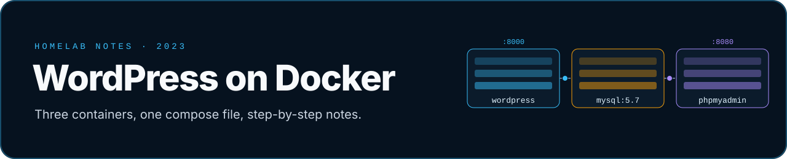
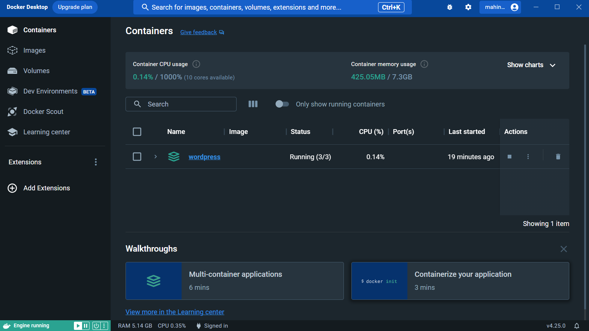

<p align="center">
  
</p>

A small home-lab project from 2023: running **WordPress, MySQL and phpMyAdmin** as three Docker containers from one
`docker-compose.yml`, written up step by step as I learned Docker on Windows with WSL.

## What's here

| File | What it is |
|---|---|
| [`docker-compose.yml`](docker-compose.yml) | the three-service stack, commented line by line |
| [`Docker proj Wordpress Documentation.md`](Docker%20proj%20Wordpress%20Documentation.md) | my setup notes, from install to a working site |
| [`Docker WordPress images.pdf`](Docker%20WordPress%20images.pdf) | screenshots of the process |
| [`WPDockerWorking.png`](WPDockerWorking.png) | the running WordPress install |

## The stack

| Service | Image | Port | Role |
|---|---|---|---|
| `wordpress` | `wordpress:latest` | `8000 → 80` | the site, at http://localhost:8000 |
| `db` | `mysql:5.7` | internal | WordPress database |
| `phpmyadmin` | `phpmyadmin/phpmyadmin:latest` | `8080 → 80` | database admin UI |

```bash
docker compose up -d      # start everything
docker compose down       # stop it
```

> ⚠️ **Lab use only.** The database passwords in `docker-compose.yml` are the example values from the
> [guide I followed](https://www.hostinger.com/tutorials/run-docker-wordpress). Change them, or move them into an
> untracked `.env` file, before running this anywhere other than your own machine. `mysql:5.7` is also end-of-life.

<p align="center"></p>
